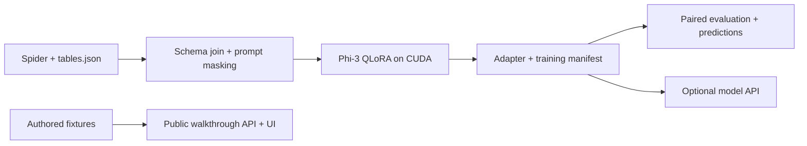

# EvalForge

**A reproducible Phi-3 Text-to-SQL fine-tuning and evaluation workbench.**

[](https://github.com/Navaneeth-007/EvalForge/actions/workflows/ci.yml)

EvalForge connects the parts of a model adaptation project that are often shown separately: schema-aware data preparation, completion-only QLoRA training, paired base/adapter evaluation, and a deployable API with an interactive walkthrough.

**Current status:** the application and training/evaluation code are implemented. No full Phi-3 training run, trained adapter, or benchmark improvement is claimed. The public walkthrough returns three authored examples and labels their source explicitly. Custom questions require model mode and a trained adapter.

## What to review

- **Model adaptation:** NF4 4-bit quantization; rank-16 LoRA on Phi-3's fused `qkv_proj` and `gate_up_proj` plus output/down projections. Prompt tokens are masked from the loss.
- **Data correctness:** Spider schemas joined from `tables.json` by `db_id`; database-separated train/validation splits retained; overlength examples filtered instead of truncating SQL targets.
- **Evaluation:** identical held-out prompts and greedy decoding for base and adapter, dataset file hashes, per-example predictions, normalized string match, bounded read-only SQLite execution, and optional BLEU/BERTScore.
- **Serving:** one lightweight FastAPI service serves the UI and API without downloading model weights. Real inference is an explicit configuration that requires an adapter.
- **Delivery:** pinned dependencies, tests, GitHub Actions, a non-root Docker image, security headers, validation, and an operations runbook.

## Run locally

Requires Python 3.11 or 3.12.

```bash
python3.11 -m venv .venv
source .venv/bin/activate
pip install -r requirements.txt
uvicorn app.main:app --host 0.0.0.0 --port 8000
```

Open [localhost:8000](http://localhost:8000) for the walkthrough, or [API documentation](http://localhost:8000/docs). No API keys are required. `.env.example` documents configuration; environment variables must be exported by your shell or deployment provider.

```bash
pip install -r requirements-dev.txt
ruff check .
pytest -q
```

## Architecture



## Train on a CUDA GPU

See [the training runbook](docs/TRAINING.md) and [Kaggle notebook](notebooks/kaggle_training.ipynb). Full training requires GPU access; the lightweight Render service is not a training machine. No training duration or GPU-memory promise is made before measurement.

```bash
pip install -r requirements-ml.txt
# Obtain Spider tables.json and databases from the official dataset release.
python -m train.dataset_prep --tables-path ./data/spider/tables.json
python -m train.train
python -m eval.run_eval \
  --adapter-dir ./outputs/phi3-sql-qlora/final \
  --eval-samples ./data/processed/eval_samples.json \
  --n 200 --use-4bit --skip-bertscore
```

The prepared dataset uses Spider validation for development. Any scores on this split are development scores, not an independent final test. The default evaluation artifact contains at most the first 200 validation examples; report the sample count and selection when publishing numbers.

## Results and evidence

| Artifact | Status |
| --- | --- |
| Application tests | Run locally; CI runs on each push |
| Full Phi-3 GPU training manifest | Pending GPU run |
| Published LoRA adapter | Pending training |
| Base vs. adapter benchmark | Pending evaluation |

Metrics are intentionally not filled with synthetic numbers. See [evaluation methodology](docs/EVALUATION.md) and [model card](model_card.md). A tiny random-model test verifies training mechanics only; it cannot demonstrate model quality.

## Deploy

The single-service walkthrough uses `requirements.txt`, starts with `uvicorn app.main:app --host 0.0.0.0 --port $PORT`, and needs no secrets. See [deployment and operations](docs/DEPLOYMENT.md) for Docker, Render, health checks, real inference configuration, and rollback.

```bash
docker build -t evalforge .
docker run --rm -p 8000:8000 evalforge
```

## Repository guide

| Path | Purpose |
| --- | --- |
| `train/` | Schema formatting, masked tokenization, QLoRA configuration, training, Hub publishing |
| `eval/` | Paired inference and metrics; protected SQLite execution |
| `app/` | API, walkthrough fixtures, same-origin browser UI |
| `tests/` | API behavior, schema joins, SQL metric and execution regressions |
| `docs/` | Training, evaluation, deployment runbooks |
| `notebooks/` | GPU training entry point |

## Scope and limitations

Generated SQL is returned as text and never executed by the public API. Execution evaluation is limited to local benchmark databases in read-only mode. This is a portfolio service with bounded single-process inference, not a multi-tenant database product. The free hosting tier may sleep when idle. Private data, credentials, customer schemas, and model weights must not be committed.

Built by [Navaneeth S](https://github.com/Navaneeth-007). Code is MIT licensed; base-model and dataset terms apply separately.
