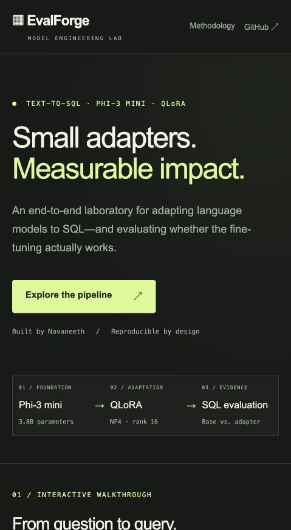
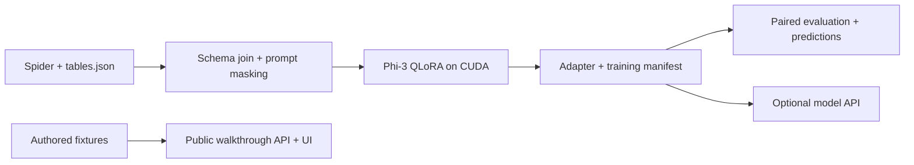

# EvalForge

**A reproducible Phi-3 Text-to-SQL fine-tuning and evaluation workbench.**

[](https://github.com/Navaneeth-007/EvalForge/actions/workflows/ci.yml)

EvalForge connects the parts of a model adaptation project that are often shown separately: schema-aware data preparation, completion-only QLoRA training, paired base/adapter evaluation, and a deployable API with an interactive walkthrough.

**Measured pilot:** adapted Phi-3 on a seed-42 selection of 1,000 Spider training examples (987 retained), then evaluated base and adapter on the same 200 held-out development questions. Execution accuracy increased **53.0% → 57.5%**; normalized exact match increased **11.0% → 26.0%**. All predictions, errors, hashes, and run metadata are published.

The deployed site is a **recorded experiment viewer**, not live model inference. It lets reviewers inspect every base prediction, adapter prediction, schema, and reference SQL. A separate model mode serves the real adapter on suitable hardware.

**[Live walkthrough](https://evalforge-024b.onrender.com) · [API reference](https://evalforge-024b.onrender.com/docs)**



[Recorded comparison preview](docs/recorded-comparison.png)

## What to review

- **Model adaptation:** NF4 4-bit quantization; rank-16 LoRA on Phi-3's fused `qkv_proj` and `gate_up_proj` plus output/down projections. Prompt tokens are masked from the loss.
- **Data correctness:** Spider schemas joined from `tables.json` by `db_id`; database-separated train/validation splits retained; overlength examples filtered instead of truncating SQL targets.
- **Evaluation:** identical held-out prompts and greedy decoding for base and adapter, dataset file hashes, per-example predictions, normalized string match, bounded read-only SQLite execution, and optional BLEU/BERTScore.
- **Serving:** one lightweight FastAPI service serves the UI and API without downloading model weights. Real inference is an explicit configuration that requires an adapter.
- **Delivery:** pinned dependencies, tests, GitHub Actions, a non-root Docker image, security headers, validation, and an operations runbook.

## Run locally

Requires Python 3.11 or 3.12.

```bash
python3.11 -m venv .venv
source .venv/bin/activate
pip install -r requirements.txt
uvicorn app.main:app --host 0.0.0.0 --port 8000
```

Open [localhost:8000](http://localhost:8000) for the walkthrough, or [API documentation](http://localhost:8000/docs). No API keys are required. `.env.example` documents configuration; environment variables must be exported by your shell or deployment provider.

```bash
pip install -r requirements-dev.txt
ruff check .
pytest -q
# Optional: after installing requirements-ml.txt, exercise real tiny Phi-3 training/evaluation:
EVALFORGE_ML_TESTS=1 pytest tests/test_training_smoke.py -q
```

## Architecture



## Train on a CUDA GPU

See [the training runbook](docs/TRAINING.md) and [Kaggle notebook](notebooks/kaggle_training.ipynb). Full training requires GPU access; the lightweight Render service is not a training machine. No training duration or GPU-memory promise is made before measurement.

```bash
pip install -r requirements-ml.txt
# Obtain Spider tables.json and databases from the official dataset release.
python -m train.dataset_prep --tables-path ./data/spider/tables.json
python -m train.train
python -m eval.run_eval \
  --adapter-dir ./outputs/phi3-sql-qlora/final \
  --eval-samples ./data/processed/eval_samples.json \
  --n 200 --use-4bit --skip-bertscore
```

The prepared dataset uses Spider validation for development. Any scores on this split are development scores, not an independent final test. The full-data preparation path saves at most the first 200 validation examples. The published pilot instead uses a seed-42 random selection of 200 validation rows; its exact prompt file and hash are included.

## Results and evidence

| Metric | Base Phi-3 | QLoRA adapter | Change |
| --- | ---: | ---: | ---: |
| Normalized exact match | 11.0% | 26.0% | +15.0 pp |
| SQLite execution accuracy | 53.0% | 57.5% | +4.5 pp |
| BLEU-4 (0–1) | 0.3878 | 0.6547 | +0.2669 |
| BERTScore | Not measured | Not measured | Skipped |

This pilot used one Tesla T4 and 25.2M trainable adapter parameters, with a 29.5-minute training loop and 4.22 GiB peak CUDA allocation. The adapter fixed 30 base-model execution errors and introduced 21 regressions: a net gain of 9/200 questions. These are custom development metrics, not an official Spider test score or a statistically established improvement.

- [Executed GPU notebook](notebooks/pilot_executed.ipynb)
- [Complete experiment and failure analysis](docs/EXPERIMENT.md)
- [Scores and all 200 recorded predictions](app/evidence/pilot.json)
- [Training manifest: configuration, revisions, hardware, package versions](reports/pilot/training_manifest.json)
- [Model card](model_card.md)
- [Download the adapter and evidence](https://github.com/Navaneeth-007/EvalForge/releases/tag/v0.1.0-pilot)

Raw generated text is scored as SQL; code fences and prose count as failures. The metric therefore includes output-format compliance. The complete 200-example record is available for independent inspection, including regressions. BERTScore was skipped.

## Deploy

The single-service recorded viewer uses `requirements.txt`, starts with `uvicorn app.main:app --host 0.0.0.0 --port $PORT`, and needs no secrets. See [deployment and operations](docs/DEPLOYMENT.md) for Docker, Render, health checks, real inference configuration, and rollback.

```bash
docker build -t evalforge .
docker run --rm -p 8000:8000 evalforge
```

## Repository guide

| Path | Purpose |
| --- | --- |
| `train/` | Schema formatting, masked tokenization, QLoRA configuration, training, Hub publishing |
| `eval/` | Paired inference and metrics; protected SQLite execution |
| `app/` | API, walkthrough fixtures, same-origin browser UI |
| `tests/` | API behavior, schema joins, SQL metric and execution regressions |
| `docs/` | Training, evaluation, deployment runbooks |
| `notebooks/` | GPU training entry point |

## Scope and limitations

Generated SQL is returned as text and never executed by the public API. Execution evaluation is limited to local benchmark databases in read-only mode. This is a portfolio service with bounded single-process inference, not a multi-tenant database product. The free hosting tier may sleep when idle. Private data, credentials, customer schemas, and model weights must not be committed.

Built by [Navaneeth S](https://github.com/Navaneeth-007). Code is MIT licensed; base-model and dataset terms apply separately.
